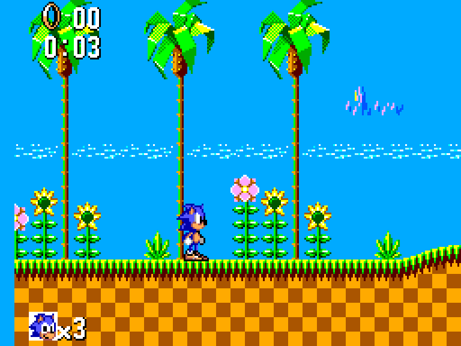
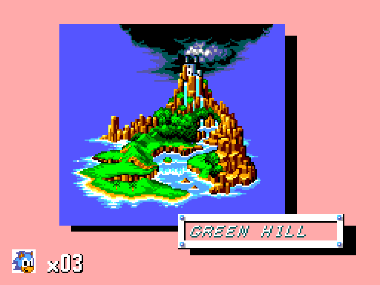

# SonicTheHedgehogSMSRecomp

Static recompilation of *Sonic the Hedgehog* (Sega Master System, 1991) into
native C, using the [smsggrecomp](https://github.com/mstan/smsggrecomp)
framework. This repo is the per-game side: the `game.toml`, the build glue, and
a pre-built release. The ROM and the generated C are **not** here — you supply
your own legally-dumped ROM and regenerate locally.

## What "static recompilation" means here

The game's Z80 machine code is translated **ahead of time** into C and compiled
to a native binary — it is not interpreted at runtime. The rest of the Master
System (VDP, SN76489 sound, controller/system ports, the Sega mapper) is modeled
by the [smsggrecomp](https://github.com/mstan/smsggrecomp) runtime. Computed
jumps the static analysis can't resolve fall back to a bundled Z80 interpreter
over the live bus. You supply your own legally-dumped copy of the ROM; it is
**never** redistributed here.

## Status

**v0.0.3 — assisted coverage pre-release.** The assisted survey covers 27 original level/bonus selectors and two ending variants through the staff roll. The 37-entry ROM-verified dispatch profile runs those routes with zero fallback. All 89 native/interpreter rendered checkpoints agree. These are assisted scene tests; full unassisted gameplay remains unverified. See [coverage details](smsggrecomp/COVERAGE.md) and [reproducible routes](tests/coverage/suite.json).

## Screenshots

Recompiled native build (no emulator), captured running the .sms ROM:

| Green Hill Zone | Zone title card |
|---|---|
|  |  |

## Quick start (pre-built release)

1. Download `SonicTheHedgehogSMSRecomp-windows-x64.zip` from
   [Releases](../../releases) and unzip it (keep `SDL2.dll` next to the `.exe`).
2. Supply your own legally-obtained *Sonic the Hedgehog (SMS)* ROM (`.sms`).
3. Run it with your ROM:
   ```
   SonicTheHedgehogSMSRecomp.exe path\to\sonicthehedgehog.sms --window 3
   ```

## Controls

| Key | Action |
|-----|--------|
| Arrow keys | D-pad |
| Z | Button 1 (jump) |
| X | Button 2 |
| Enter | Start / Pause |
| Esc | Quit |

## ROM

| Field | Value |
|-------|-------|
| Title | Sonic the Hedgehog (SMS) |
| Region | USA / Europe / Brazil (identical retail image) |
| CRC32 | `0xB519E833` |
| Size | 256 KB |

The ROM is **never** redistributed — supply your own legally-dumped copy.

## Building from source

Initialize recursive submodules and install native Windows CMake, Ninja, GCC
and SDL2 (the helper defaults to MSYS2 `C:\msys64\mingw64`). The shared build
graph builds the recompiler and regenerates the native C from your own ROM:

```powershell
git submodule update --init --recursive
powershell -File build.ps1 -Rom 'path\to\sonicthehedgehog.sms'
.\build\SonicTheHedgehogSMSRecomp.exe 'path\to\sonicthehedgehog.sms' --window 3
```

`-Build` accepts an absolute directory; invoking the script from another
directory still builds this project. `-Framework` selects an alternate engine
checkout. `-SkipRegenerate` requires compatible generated sources already on
disk. Generated C and ROMs are ignored and are not distributed.

For a deterministic coverage run:

```text
python smsggrecomp/tools/run_coverage_suite.py --runtime build/SonicTheHedgehogSMSRecomp.exe --rom path/to/sonicthehedgehog.sms --suite tests/coverage/suite.json --out coverage-new
```

## Repo layout

| Path | Purpose |
|------|---------|
| `game.toml` | Per-game config: ROM identity, mapper, RAM layout, discovery seeds, jump tables. |
| `build.ps1` | Regenerate from your ROM + build the windowed exe. |
| `smsggrecomp/` | Pinned engine submodule used to build the game. |
| `generated/` | Recompiler output (gitignored; regenerated from your ROM). |

## License

Not yet declared. Code in this repo is original. The *Sonic the Hedgehog* ROM
and any data derived from it are **not** in this repo and are not licensed for
redistribution.

---

<p align="center">
  <sub><b>R.A.I.D. — Retro AI Development</b> · a Discord for AI-assisted retro reverse-engineering, decomp &amp; recomp</sub>
</p>

<p align="center">
  <a href="https://discord.gg/Ad9BwSzctP"></a>
</p>
