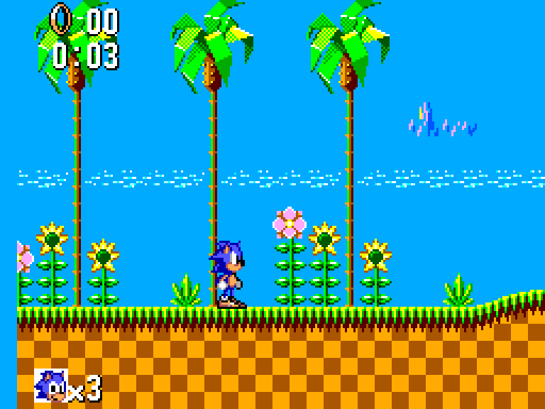
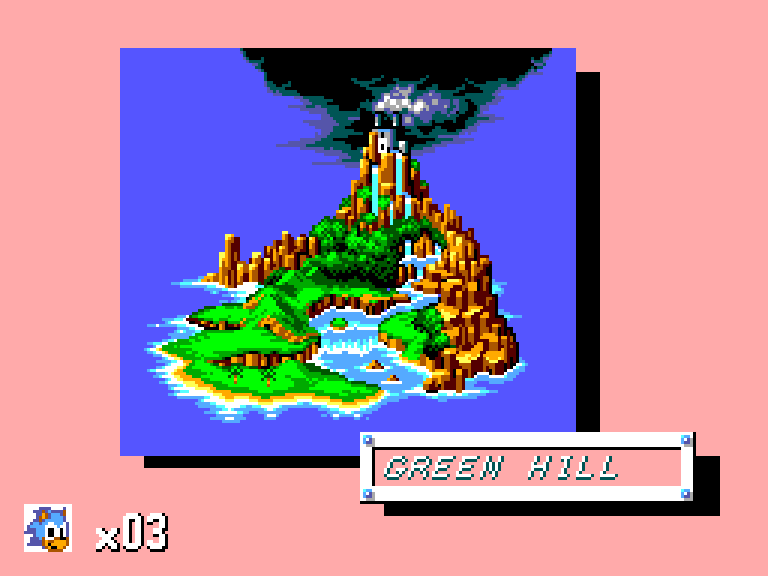

# SonicTheHedgehogSMSRecomp

Static recompilation of *Sonic the Hedgehog* (Sega Master System, 1991) into
native C, using the [smsggrecomp](https://github.com/mstan/smsggrecomp)
framework. This repo is the per-game side: the `game.toml`, the build glue, and
a pre-built release. The ROM and the generated C are **not** here — you supply
your own legally-dumped ROM and regenerate locally.

## What "static recompilation" means here

The game's Z80 machine code is translated **ahead of time** into C and compiled
to a native binary — it is not interpreted at runtime. The rest of the Master
System (VDP, SN76489 sound, controller/system ports, the Sega mapper) is modeled
by the [smsggrecomp](https://github.com/mstan/smsggrecomp) runtime. Computed
jumps require generated coverage; an unsupported native target stops with a
coverage error. You supply your own legally-dumped copy of the ROM; it is
**never** redistributed here.

## Status

**v0.0.4 — assisted coverage pre-release.** The assisted survey covers 27 original level/bonus selectors and two ending variants through the staff roll. The ROM-verified dispatch profile runs those routes with zero fallback. The retained reference survey records 89 matching native/interpreter rendered checkpoints; the current coverage command runs HLE only. These are assisted scene tests; full unassisted gameplay remains unverified. See [coverage details](smsggrecomp/COVERAGE.md) and [reproducible routes](tests/coverage/suite.json).

## Screenshots

Recompiled native build (no emulator), captured running the .sms ROM:

| Green Hill Zone | Zone title card |
|---|---|
|  |  |

## Quick start (pre-built release)

1. Download `SonicTheHedgehogSMSRecomp-windows-x64.zip` from
   [Releases](../../releases) and unzip it (keep `SDL2.dll` next to the `.exe`). License notices are in
   `licenses/`.
2. Supply your own legally-obtained *Sonic the Hedgehog (SMS)* ROM (`.sms`).
3. Run it with your ROM:
   ```
   SonicTheHedgehogSMSRecomp.exe path\to\sonicthehedgehog.sms --window 3
   ```

For faithful 16x internal resolution, add `--internal-scale 16`, or drag your ROM onto
`Play 16x.cmd` in the release ZIP. Tile artwork stays sharp with no smoothing or
invented detail. `Play.cmd` uses the normal native-resolution display. Both run
with normal audio. An unsupported GPU falls back to native output.

## Controls

| Key | Action |
|-----|--------|
| Arrow keys | D-pad |
| Z | Button 1 (jump) |
| X | Button 2 |
| Enter | Start / Pause |
| Esc | Quit |

## ROM

| Field | Value |
|-------|-------|
| Title | Sonic the Hedgehog (SMS) |
| Region | USA / Europe / Brazil (identical retail image) |
| CRC32 | `0xB519E833` |
| Size | 256 KB |

The ROM is **never** redistributed — supply your own legally-dumped copy.

## Building from source

Initialize recursive submodules and install native Windows CMake, Ninja, GCC
and SDL2 (the helper defaults to MSYS2 `C:\msys64\mingw64`). The shared build
graph builds the recompiler and regenerates the native C from your own ROM:

```powershell
git submodule update --init --recursive
powershell -File build.ps1 -Rom 'path\to\sonicthehedgehog.sms'
.\build\SonicTheHedgehogSMSRecomp.exe 'path\to\sonicthehedgehog.sms' --window 3
```

`-Build` accepts an absolute directory; invoking the script from another
directory still builds this project. `-Framework` selects an alternate engine
checkout. `-SkipRegenerate` requires compatible generated sources already on
disk. Generated C and ROMs are ignored and are not distributed.

For a deterministic host-native HLE coverage run (no interpreter is launched):

```text
python smsggrecomp/tools/run_coverage_suite.py --runtime build/SonicTheHedgehogSMSRecomp.exe --rom path/to/sonicthehedgehog.sms --suite tests/coverage/suite.json --out coverage-new
```

### Packaging a release

```powershell
powershell -File smsggrecomp/tools/package_game_release.ps1 -ProjectRoot .
```

This stages the built exe, its verified runtime DLL closure, launcher assets, `Play.cmd`/`Play 16x.cmd`,
`README.txt` (from [`packaging/README.txt.in`](packaging/README.txt.in)) and
every license notice under `licenses/`, then writes
`release/SonicTheHedgehogSMSRecomp-windows-x64.zip`. It fails if required assets, runtime dependencies or notices are missing, and reopens the ZIP to verify its contents. Double-click `Play.cmd` to select your original image; dragging an image onto it also works.

## Repo layout

| Path | Purpose |
|------|---------|
| `game.toml` | Per-game config: ROM identity, mapper, RAM layout, discovery seeds, jump tables. |
| `build.ps1` | Regenerate from your ROM + build the windowed exe. |
| `packaging/` | Release README template for the shared packager. |
| `smsggrecomp/` | Pinned engine submodule used to build the game. |
| `generated/` | Recompiler output (gitignored; regenerated from your ROM). |

## License

PolyForm Noncommercial 1.0.0, with [additional permissions](PERMISSIONS.md)
for voluntary donations and advertising revenue. See [`LICENSE`](LICENSE) for
the standard license and [`PERMISSIONS.md`](PERMISSIONS.md) for the grant and
its conditions. Payment must not buy access to the software, games built with
it, or their updates, features, or game content, including early access.

Copyright © 2026 Matthew Stanley. Matthew Stanley has authority from the relevant
copyright holders to grant the additional permissions for SonicTheHedgehogSMSRecomp's project
code, as stated in [`PERMISSIONS.md`](PERMISSIONS.md). Licensing inquiries go to
him at <https://1379.tech>.

By contributing, you license your contribution under the project's
[PolyForm Noncommercial License 1.0.0](LICENSE), grant the
[additional permissions in `PERMISSIONS.md`](PERMISSIONS.md) for the rights you
control in your contribution, and authorize Matthew Stanley to grant those same
additional permissions for it.

The [smsggrecomp](https://github.com/mstan/smsggrecomp) engine and its
third-party components keep their own terms; release ZIPs carry every notice
under `licenses/`. The *Sonic the Hedgehog* ROM and any data derived from it,
including generated C, are **not** in this repo and are not licensed for
redistribution.

---

<p align="center">
  <sub><b>R.A.I.D. — Retro AI Development</b> · a Discord for AI-assisted retro reverse-engineering, decomp &amp; recomp</sub>
</p>

<p align="center">
  <a href="https://discord.gg/Ad9BwSzctP"></a>
</p>
